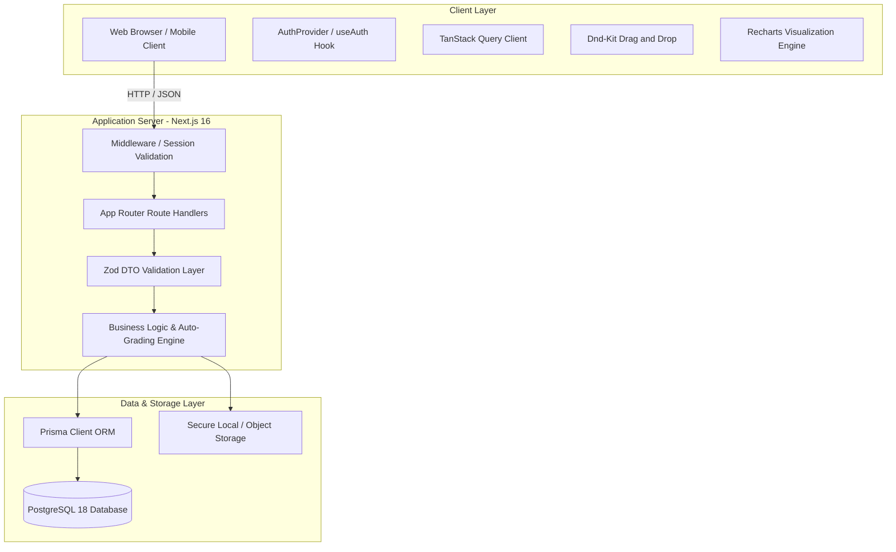

# FormCraft — System Architecture

This document describes the architectural principles, component structure, data flow, and design patterns utilized in FormCraft.

---

## 1. High-Level Architecture Diagram



---

## 2. Directory Structure

```text
src/
├── app/
│   ├── (auth)/
│   │   ├── login/page.tsx               # Interactive login with demo shortcuts
│   │   ├── register/page.tsx            # User registration
│   │   └── layout.tsx                   # Auth layout with FormCraft branding
│   ├── (editor)/
│   │   └── forms/[id]/page.tsx          # Visual WYSIWYG Form Builder
│   ├── f/
│   │   └── [publicId]/page.tsx          # Public respondent submission wizard
│   ├── api/
│   │   ├── auth/                        # login, register, logout, me
│   │   ├── forms/                       # form CRUD, duplicate, publish, unpublish
│   │   │   └── [id]/
│   │   │       ├── questions/           # question CRUD & reordering
│   │   │       ├── sections/            # multi-section management
│   │   │       ├── responses/           # summary, individual, analytics, export
│   │   │       └── collaborators/       # collaborator RBAC & invitations
│   │   ├── public/                      # public form schema & submissions
│   │   ├── uploads/                     # secure file upload
│   │   └── templates/                   # pre-built templates
│   ├── globals.css                      # Tailwind styling & tokens
│   ├── layout.tsx                       # Root layout with Query & Auth providers
│   └── page.tsx                         # Main Dashboard (forms, search, filters)
├── components/
│   ├── ui/                              # Radix primitives (Button, Input, Select, Dialog, etc.)
│   ├── dashboard/                       # Header, TemplateGallery, FormCard
│   ├── form-builder/                    # BuilderHeader, QuestionCard, SectionCard, ThemeDrawer, ResponsesTab, SettingsTab
│   └── shared/                          # QueryProvider
├── lib/
│   ├── db/prisma.ts                     # Singleton Prisma client
│   ├── auth/                            # JWT, bcrypt password hashing, session, RBAC
│   ├── validation/                      # Zod validation schemas
│   ├── storage/                         # Local secure file storage
│   ├── templates/                       # 10 production-ready templates
│   └── utils.ts                         # Formatting, formula injection defense
├── tests/
│   └── integration.test.ts              # End-to-end integration test suite
└── prisma/
    ├── schema.prisma                    # PostgreSQL schema definition
    └── seed.ts                          # Database seeder script
```

---

## 3. Core Architectural Patterns

### 3.1 Immutable Published Form Versions
When a form creator clicks **Publish**, the application creates an immutable `FormVersion` record containing a complete JSON snapshot of all sections, questions, options, theme settings, and validation rules at that moment in time.
Subsequent form responses are explicitly associated with that specific `FormVersion`:
- Edits made in draft mode do not invalidate in-flight submissions.
- Historical analytics and exports accurately reflect the exact wording and options seen by the respondent.

### 3.2 Command History & Undo/Redo Engine
The visual form builder maintains an in-memory command stack (`historyRef`) capturing snapshots of the form state on every mutation:
- Users can step backward and forward through changes (`Ctrl+Z`, `Ctrl+Y`).
- Protects against user error during complex restructuring or question reordering.

### 3.3 Debounced Optimistic Auto-Save
Form changes are optimistically reflected in the editor UI and saved to the server using a debounced timer (1000ms delay):
- The header displays real-time status: `Saving...`, `All changes saved in cloud`, or `Save failed`.
- Mitigates network thrashing while guaranteeing state synchronization.

### 3.4 Security-Stripped Public Endpoint
When a respondent requests `/api/public/forms/[publicId]`, all sensitive metadata is stripped on the server:
- Quiz answer keys (`quizAnswer`) are omitted so respondents cannot inspect network payloads.
- Collaborator information, audit logs, and owner details are strictly excluded.
