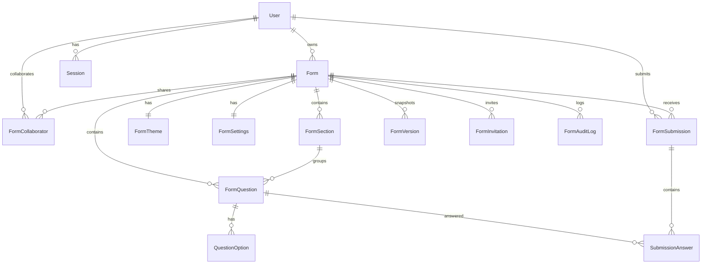

# FormCraft — Database Architecture & Schema Reference

FormCraft utilizes a normalized PostgreSQL database managed through Prisma ORM.

---

## Entity Relationship Overview

---

## Table Schemas & Fields

### 1. `users`
| Column | Type | Constraints | Description |
|---|---|---|---|
| `id` | String (cuid) | Primary Key | Unique user identifier |
| `email` | String | Unique, Indexed | User login email |
| `name` | String? | Nullable | User full name |
| `passwordHash` | String | Not Null | Bcrypt hashed password |
| `role` | Enum (`USER`, `ADMIN`) | Default `USER` | Global platform authorization |
| `avatarUrl` | String? | Nullable | Profile picture URL |
| `createdAt` | DateTime | Default `now()` | Registration timestamp |

### 2. `forms`
| Column | Type | Constraints | Description |
|---|---|---|---|
| `id` | String (cuid) | Primary Key | Internal form ID |
| `publicId` | String (cuid) | Unique, Indexed | Public slug for respondent URL (`/f/[publicId]`) |
| `title` | String | Default "Untitled form" | Form title |
| `description` | String? | Nullable | Optional form instructions |
| `status` | Enum | `DRAFT`, `PUBLISHED`, `ARCHIVED`, `TRASHED` | Lifecycle status |
| `ownerId` | String | FK to `users.id`, Indexed | Form creator/owner |
| `isQuiz` | Boolean | Default `false` | Enables quiz mode & scoring |
| `publishedVersionId` | String? | Nullable | Pointer to active published snapshot |

### 3. `form_sections`
| Column | Type | Constraints | Description |
|---|---|---|---|
| `id` | String (cuid) | Primary Key | Section identifier |
| `formId` | String | FK to `forms.id`, Cascade Delete | Parent form |
| `title` | String | Default "Section" | Section header title |
| `description` | String? | Nullable | Section guidance |
| `orderIndex` | Int | Default 0, Indexed | Sequential ordering |
| `nextSectionId` | String? | Default "NEXT" | Routing rule ("NEXT", "SUBMIT", or target section ID) |

### 4. `form_questions`
| Column | Type | Constraints | Description |
|---|---|---|---|
| `id` | String (cuid) | Primary Key | Question identifier |
| `formId` | String | FK to `forms.id`, Cascade Delete | Parent form |
| `sectionId` | String | FK to `form_sections.id`, Cascade Delete | Owning section |
| `title` | String | Not Null | Question label |
| `type` | String | Not Null | Question type (`SHORT_ANSWER`, `MULTIPLE_CHOICE`, etc.) |
| `orderIndex` | Int | Indexed | Ordering within section |
| `isRequired` | Boolean | Default `false` | Mandatory validation rule |
| `validation` | Json | Default `{}` | Min/max length, regex, min/max selections |
| `config` | Json | Default `{}` | Scales, grids (rows/cols), file upload limits |
| `quizPoints` | Int | Default 0 | Point value in quiz mode |
| `quizAnswer` | Json | Default `{}` | Correct answer keys |
| `quizExplanation` | String?| Nullable | Feedback displayed after grading |

### 5. `question_options`
| Column | Type | Constraints | Description |
|---|---|---|---|
| `id` | String (cuid) | Primary Key | Option identifier |
| `questionId` | String | FK to `form_questions.id`, Cascade Delete | Parent question |
| `label` | String | Not Null | Display label |
| `value` | String | Not Null | Value stored in submissions |
| `orderIndex` | Int | Default 0 | Position in choice list |
| `isOther` | Boolean | Default `false` | Indicates "Other..." option |
| `goToSectionId`| String?| Nullable | Conditional branching destination section |

### 6. `form_versions`
| Column | Type | Constraints | Description |
|---|---|---|---|
| `id` | String (cuid) | Primary Key | Snapshot version ID |
| `formId` | String | FK to `forms.id`, Cascade Delete | Form reference |
| `versionNumber` | Int | Not Null | Sequential version (1, 2, 3...) |
| `snapshotJson` | Json | Not Null | Complete JSON tree of form at publish time |
| `publishedAt` | DateTime | Default `now()` | Timestamp of publish event |

### 7. `form_submissions`
| Column | Type | Constraints | Description |
|---|---|---|---|
| `id` | String (cuid) | Primary Key | Submission record ID |
| `formId` | String | FK to `forms.id`, Cascade Delete, Indexed | Form submitted to |
| `formVersionId`| String? | FK to `form_versions.id` | Snapshot used during submission |
| `respondentEmail`| String? | Nullable | Email if collected |
| `editToken` | String | Unique | Token for respondent response editing |
| `ipHash` | String? | Nullable | Hash of respondent IP for rate protection |
| `idempotencyKey`| String? | Unique | Prevents duplicate submissions on network retries |
| `totalScore` | Float? | Nullable | Total points scored (quizzes) |
| `maxScore` | Float? | Nullable | Maximum possible points |
| `submittedAt` | DateTime | Default `now()`, Indexed | Submission timestamp |

### 8. `submission_answers`
| Column | Type | Constraints | Description |
|---|---|---|---|
| `id` | String (cuid) | Primary Key | Answer record ID |
| `submissionId` | String | FK to `form_submissions.id`, Cascade Delete | Parent submission |
| `questionId` | String | FK to `form_questions.id`, Cascade Delete | Question answered |
| `value` | Json | Not Null | Typed answer (string, string[], object for grid) |
| `score` | Float? | Nullable | Points earned for this question |
| `isCorrect` | Boolean?| Nullable | Correctness flag (quizzes) |

---

## Indexing Strategy
- `[ownerId]`: Fast retrieval of user forms on Dashboard.
- `[publicId]`: O(1) lookup of public form pages by slug.
- `[formId, orderIndex]`: Ordered rendering of sections and questions.
- `[formId, submittedAt]`: High-performance timeline aggregation in analytics.
- `[idempotencyKey]`: Instant duplicate submission detection.
